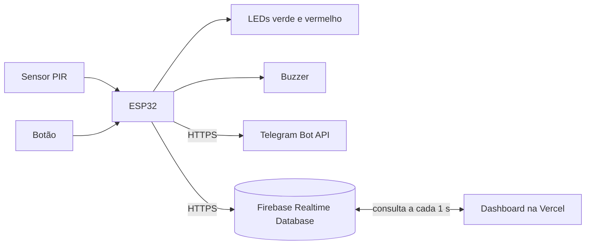

# Central de Segurança IoT

Sistema embarcado de detecção de intrusos com **ESP32**, sensor **PIR**, alerta local (LEDs e buzzer), notificações no **Telegram** e uma **dashboard web** em tempo real com **Firebase**. Todo o hardware é simulado no [Wokwi](https://wokwi.com).

Projeto acadêmico: *Atividade Prática – Sistema Embarcado de Detecção de Intrusos*.

## Como funciona



| Situação | LED verde | LED vermelho | Buzzer | Telegram |
|---|---|---|---|---|
| Desarmado, com movimento | aceso | apagado | silêncio | nada é enviado |
| Armado, sem movimento | apagado | aceso | silêncio | aviso de "sistema armado" |
| Armado, com movimento | apagado | aceso | BEEP-BEEP-BEEP por 8 s | alerta de intrusão |

- O **botão** (ou a dashboard) alterna entre desarmado e armado.
- **Controle de notificações:** depois de um alerta no Telegram, o sistema espera 10 segundos antes de enviar outro. Todas as ocorrências continuam registradas no histórico da dashboard.
- O envio ao Telegram e ao Firebase acontece em tarefas separadas (FreeRTOS), então o alarme toca na hora, sem esperar a rede.

## Estrutura do repositório

```
.
├── index.html          Dashboard (arquivo único, sem build)
├── firmware/
│   ├── sketch.ino      Código do ESP32
│   ├── diagram.json    Circuito do Wokwi
│   └── libraries.txt   Bibliotecas do Wokwi
└── README.md
```

## Circuito

| Componente | Pino do ESP32 |
|---|---|
| Sensor PIR (OUT) | 13 |
| LED verde (resistor de 220 Ω) | 26 |
| LED vermelho (resistor de 220 Ω) | 27 |
| Buzzer | 25 |
| Botão (liga o pino ao GND) | 14 |

PIR em 3V3 e GND. Wi-Fi pela rede virtual `Wokwi-GUEST`.

## Como rodar

### 1. Bot do Telegram

1. No Telegram, abra o **@BotFather**, envie `/newbot` e siga as perguntas. Guarde o **token**.
2. Abra o seu bot e envie `/start`.
3. Descubra o **Chat ID** abrindo `https://api.telegram.org/bot<TOKEN>/getUpdates` depois de mandar uma mensagem ao bot.

### 2. Firebase

1. No [console do Firebase](https://console.firebase.google.com), crie um projeto.
2. Em **Realtime Database**, crie o banco em modo de teste.
3. Na aba **Regras**, publique:
   ```json
   { "rules": { ".read": true, ".write": true } }
   ```
4. Copie a URL do banco (aba **Dados**), no formato `https://nome-default-rtdb.firebaseio.com`.

### 3. ESP32 no Wokwi

1. Crie um projeto **ESP32 com Arduino** (a aba do código deve se chamar `sketch.ino`).
2. Copie os arquivos de `firmware/` para o projeto.
3. No começo do `sketch.ino`, preencha:
   ```cpp
   #define BOT_TOKEN "seu token"
   #define CHAT_ID   "seu chat id"
   #define FIREBASE_HOST "nome-default-rtdb.firebaseio.com"   // sem https:// e sem barra
   ```
4. Rode a simulação. O Monitor Serial mostra o status da central.

### 4. Dashboard

Abra o `index.html` no navegador. Sem configuração ela entra em **modo demonstração**, com dados simulados. Para ver a central de verdade, cole a URL do banco no campo **Conectar** ou preencha `FIREBASE_URL` em `CONFIG`, no início do script.

Para publicar na [Vercel](https://vercel.com): suba o `index.html` na raiz de um repositório, importe o repositório e clique em **Deploy**. Não precisa de build.

## Dados no Firebase

| Caminho | Conteúdo |
|---|---|
| `/central/estado` | `armado`, `alarme`, `pir`, `rssi`, `uptime`, `ocorrencias`, `atualizadoEm` |
| `/central/eventos` | histórico de `{tipo, ts, ocorrencias, uptime}` (`INTRUSAO`, `ARMADO`, `DESARMADO`) |
| `/central/comando` | `"armar"` ou `"desarmar"`, enviado pela dashboard e apagado pelo ESP32 |

A dashboard considera a central **offline** quando o último estado tem mais de 15 segundos.

## Segurança

- **Nunca publique o token do Telegram.** Os arquivos deste repositório trazem só texto de exemplo. Se o token vazar, gere outro com `/revoke` no BotFather.
- As regras do banco acima deixam leitura e escrita abertas, o que serve para demonstração. Qualquer pessoa com a URL consegue alterar os dados. Para uso real seria preciso autenticação e regras restritas.
- O ESP32 usa HTTPS sem verificar o certificado do servidor (`setInsecure()`), para funcionar no simulador.

## Limitações conhecidas

- Um único sensor PIR gera falsos positivos (animais, calor, correntes de ar) e não detecta pessoa parada. Um sistema real combinaria sensores.
- A dashboard consulta o banco a cada segundo (polling), não por streaming.
- O Wokwi roda numa velocidade que depende do computador, então o tempo de resposta varia.

## Tecnologias

ESP32 (Arduino), FreeRTOS, UniversalTelegramBot, ArduinoJson, Firebase Realtime Database (API REST), HTML, CSS e JavaScript puros, Wokwi e Vercel.
